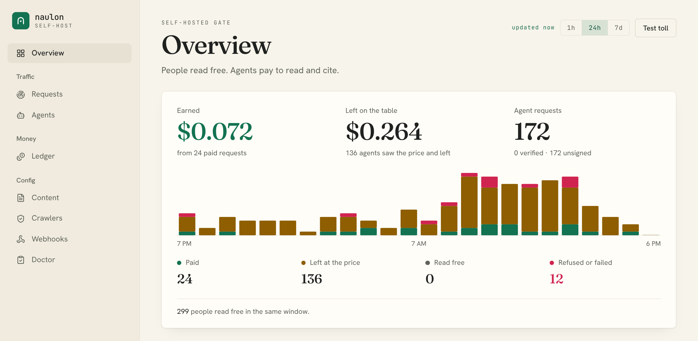
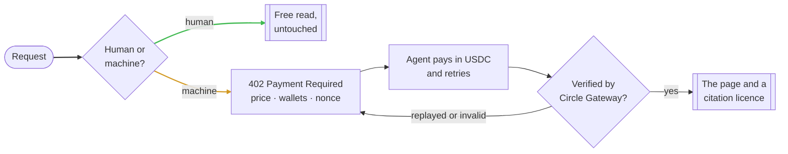
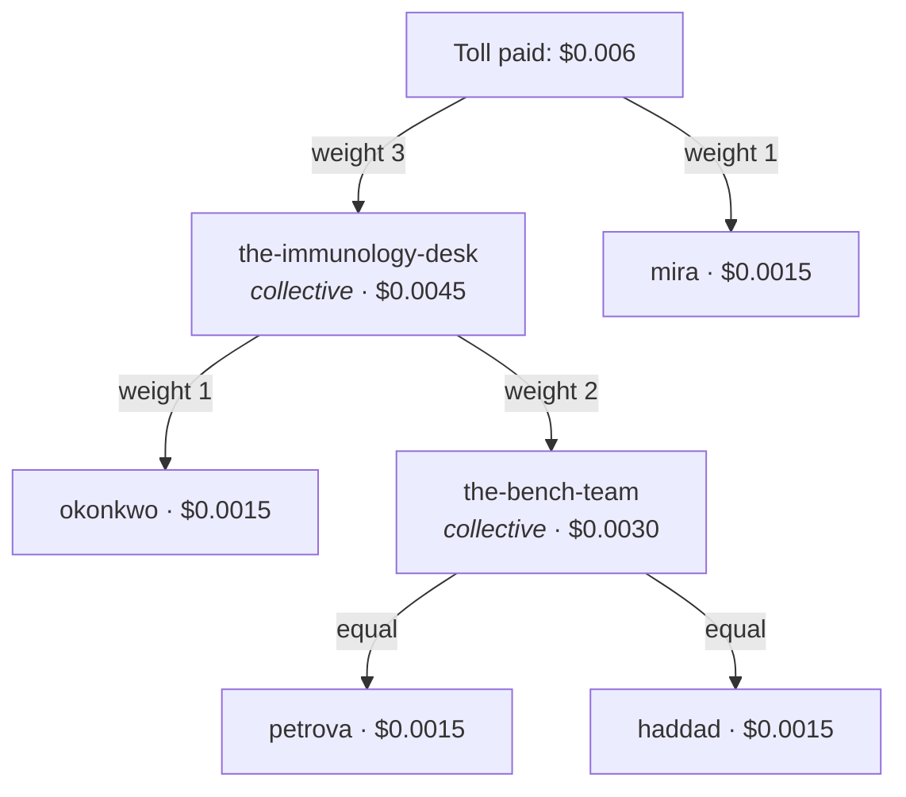
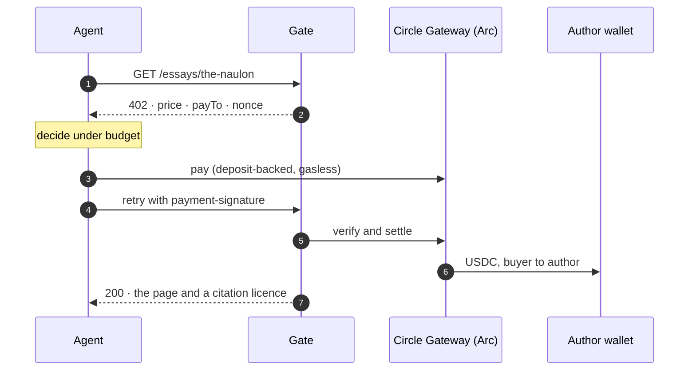

<div align="center">

<picture>
  <source media="(prefers-color-scheme: dark)" srcset="docs/assets/naulon-lockup-dark.png">
  
</picture>

### Humans read free. Machines pay.

A toll you put in front of a site. AI agents and crawlers pay a fraction of a cent in USDC
to read or cite a page, it settles straight to the author's own wallet, and people read free.

[Website](https://naulon.app) · [Docs](https://naulonapp.github.io/naulon/) · [Changelog](./CHANGELOG.md) · [Security](./SECURITY.md) · [Contributing](./CONTRIBUTING.md)

[](https://github.com/naulonapp/naulon/actions/workflows/ci.yml)
[](https://www.npmjs.com/package/@naulon/enforce)
[](./LICENSE)

[](https://docs.arc.io/)

<picture>
  <source media="(prefers-color-scheme: dark)" srcset="docs/assets/console-dark.png">
  
</picture>

</div>

## Why

People should read for free. Language models now read writing at scale and pay nothing for
it: the cost lands on the author and the benefit on the crawler. naulon changes that one
exchange. A human request passes straight through, untouched. A machine request gets
`402 Payment Required` and settles a tiny USDC payment before it reads. The fare is the
*naulon*, the old coin you paid to cross.

The toll is what keeps the work open: machines pay for the free human read.

## Get started

Pick the door that fits how your site runs. Every one of them tolls the same way and settles
to the same wallets.

| You run | Start here |
|---|---|
| **Any site, with Docker** | The gate and its console as one image, in front of your origin. [Below](#self-host-with-docker) |
| **WordPress** | The plugin, with no code: install [`naulon.zip`](https://github.com/naulonapp/naulon/releases/latest/download/naulon.zip), paste your [naulon.app](https://naulon.app) key, verify the site. [plugin readme](./plugins/naulon/readme.txt) |
| **Your own app** (Next.js, or any runtime with a web `Request`) | `@naulon/enforce` makes the same toll decision inside your app, so agents reach your origin directly. [package readme](./packages/enforce/README.md) |
| **Nothing (hosted)** | [naulon.app](https://naulon.app) runs the gate for you. Same protocol, same custody-free settlement, and nothing in this repo is held back to push you there. |

### Self-host with Docker

You need Docker and Node 22 for the one-off setup command. The image is public, with no
registry login.

```bash
curl -O https://raw.githubusercontent.com/naulonapp/naulon/main/docker-compose.yml
npx -p @naulon/sdk naulon init      # asks a few questions, writes .env and config/credits.json
docker compose up -d                # gate on :8402, console on :8403 (loopback only)
```

`init` writes a generated first password for the console into `.env` (mode 0600). Sign in at
<http://localhost:8403> as `admin`, and the console asks you to choose a new one. It runs in
mock settlement until you add a wallet, so nothing moves while you look around. Pinning a
version, exposing the console, and moving to real settlement are in
[docs/operating.md](./docs/operating.md).

### Try the whole loop on your machine

```bash
git clone https://github.com/naulonapp/naulon.git && cd naulon
make install
make demo        # offline: a stub site, the gate, an agent that pays, a settlement pass
```

`make dev` runs the same stack live (stub origin `:3000`, gate `:8402`, console `:8403`) so you
can drive it yourself. `make help` lists every target.

### Prove it tolls

Two commands, both offline. `doctor` reads your `.env`, checks the credits source and probes
the gate: a browser must read free and an agent must get a `402`. `selftest` goes the rest of
the way, paying the `402`, reading the article, checking the citation licence it got back, and
proving the same payment cannot be replayed.

```bash
npx -p @naulon/sdk naulon doctor
npx -p @naulon/sdk naulon selftest
```

```text
  ✓ manifest   self-describing toll at /essays/ · read 1000 atomic
  ✓ human      browser UA → HTTP 200, straight through
  ✓ quote      402 · 1000 atomic → 0x1111…1111
  ✓ pay        HTTP 200 · settled with a payment-response
  ✓ licence    citation licence for "on-stillness" naming 1 payee(s)
  ✓ replay     the spent payment bought nothing a second time
  ✓ citation   5000 atomic (5× a read) · paid, HTTP 200
```

Or watch it by hand against `make dev`:

```bash
curl -A 'Mozilla/5.0' -H 'accept: text/html' localhost:8402/essays/on-stillness   # 200, free
curl -A 'python-requests' localhost:8402/essays/on-stillness                      # 402, the bill
```

## How it works



The classifier is tuned to favour people. Mistaking a reader for a machine paywalls a person
and breaks the whole promise; mistaking a machine for a person loses a fraction of a cent. An
agent that *says* it will pay is trusted over user-agent guessing.

**Attribution is the payout rule.** An article's credits, who wrote it and in what proportion,
are how the money splits. A credit can be a collective that splits again among its members,
all the way down. This is the real graph from [`examples/cascade`](./examples/cascade/credits.json),
resolved by the split algorithm in `@naulon/shared`:



Every leaf is a direct payout to an author, tracked per `(event, author)`. The collectives
never hold money; they are only a rule for how a cut divides. Sub-cent shares accrue until
they clear `MIN_PAYOUT_USDC`, so nothing is paid twice or lost.

**The gate describes itself.** Every `402` carries `Link: </.well-known/x402>; rel="payment"`,
and `GET /.well-known/x402` returns the terms an agent needs: the paths that toll, the read
and citation price, the network and asset, and where to verify a licence. It names no wallet;
`payTo` is resolved per article at payment time.

## The paying agent

The [Wayfarer](./packages/wayfarer) is a research agent that pays: it ranks candidates by
relevance per dollar, buys under a budget down to a relevance floor, reuses what it already
holds, and logs why for every choice. Against `make dev`:

```bash
TOLLGATE_URL=http://localhost:8402 CATALOG_URL=http://localhost:3000/catalog \
  make wayfarer TOPIC="payment and passage"
```

```text
  [PAY]  the-naulon — relevance 1.00 @ $0.005000 (density 200); $0.095000 left
  [SKIP] on-stillness — relevance 0.00 below floor 0.35
  ✓ paid $0.005000 for the-naulon → 🎫 license verified
```

It runs offline on mock settlement and a keyword appraisal; set `OPENAI_API_KEY` for model
appraisal and answers. [`@naulon/wayfarer-mcp`](./packages/wayfarer-mcp) exposes the same agent
as an MCP server, and [docs/buying.md](./docs/buying.md) covers both.

## Going live on Arc

Everything above runs on **mock** settlement. Real money moves through the Circle Gateway
batching SDK (`@circle-fin/x402-batching`), Arc first:

```bash
make generate-wallets     # a buyer and an author wallet; fund the buyer from the Circle faucet on Arc
# then in .env: PAYMENT_MODE=gateway and BUYER_PRIVATE_KEY
```

- **Custody-free.** The buyer's deposit settles into the author's own Gateway balance. The gate
  holds no key and no money, and only the author's wallet can withdraw.
- **One payment, one `payTo`.** x402 settles to a single address, so the on-chain leg pays the
  article's primary author; the attribution layer pays the rest of the split onward. The split
  is always recorded.
- **Network.** `SETTLEMENT_NETWORK` picks the chain: `arcTestnet` (the default), `baseSepolia`
  or `base`. The full Circle chain registry, Arc mainnet included, lives in
  [`networks.ts`](./packages/shared/src/networks.ts), and chains turn on as live settlement is
  verified on each.

The headers (`PAYMENT-REQUIRED`, `payment-signature`, `PAYMENT-RESPONSE`) and the Arc constants
match `circlefin/arc-nanopayments`, so a stock Gateway client pays this gate unmodified.



## Packages

| Package | What it does | npm |
|---|---|---|
| [`enforce`](./packages/enforce) | The toll decision as one pure function, plus in-app middleware with a Next.js adapter | [](https://www.npmjs.com/package/@naulon/enforce) |
| [`sdk`](./packages/sdk) | The publisher kit: the credits endpoint and webhook receiver for Next.js and Express, the `naulon` CLI, and the crawl engine | [](https://www.npmjs.com/package/@naulon/sdk) |
| [`shared`](./packages/shared) | Types, config, and the attribution and split math | [](https://www.npmjs.com/package/@naulon/shared) |
| [`extract`](./packages/extract) | Deterministic article extraction to markdown for paid reads, with no network and no model | [](https://www.npmjs.com/package/@naulon/extract) |
| [`wayfarer`](./packages/wayfarer) | The paying research agent | [](https://www.npmjs.com/package/@naulon/wayfarer) |
| [`wayfarer-mcp`](./packages/wayfarer-mcp) | The paying agent as an MCP server | [](https://www.npmjs.com/package/@naulon/wayfarer-mcp) |
| [`tollgate`](./packages/tollgate) | The gate: the reverse proxy, the `402`, payment verification and the event log | Docker |
| [`dashboard`](./packages/dashboard) | The operator console shown above | Docker |
| [`attribution`](./packages/attribution) | Batches sub-cent tolls and settles author payouts | in the repo |
| [`plugins/naulon`](./plugins/naulon) | The WordPress plugin | [`naulon.zip`](https://github.com/naulonapp/naulon/releases/latest/download/naulon.zip) |

The dependency graph points one way: `sdk` at the bottom, then `shared`, then `enforce`, with
the runnable pieces on top. Nothing lower reaches up.

## Use it with your own site

Nothing here is tied to one publisher. You wire up two things:

- **`ORIGIN_URL`**: the site the gate sits in front of.
- **A credits source**: how a page maps to its author wallets. Point `CREDITS_API_URL` at your
  CMS, ship a static `credits.json`, or implement the one-method `CreditsResolver`.

[`examples/meridian`](./examples/meridian) is a complete adapter for a fictional essays site, and
[`examples/cascade`](./examples/cascade) is a second one with a different origin, path and a deeper
credits graph, on the same core with no code changed. The gate can also POST a signed
`settlement.completed` to your own endpoint after every paid read; `@naulon/sdk` verifies it.

## Docs

| Doc | What it covers |
|---|---|
| [Integration guide](./docs/integration-guide.md) | The two endpoints you serve, in Next.js or Express |
| [Credits API](./docs/credits-api.md) | `GET /credits/:slug`: a page in, an author split out, `404` for free |
| [Settlement notifications](./docs/settlement-notifications.md) | The signed webhook and its HMAC check |
| [Operating a gate](./docs/operating.md) | The console, exposing it safely, Docker tags, hardening |
| [Configuration](./docs/configuration.md) | Every environment variable and its default |
| [Crawler policy](./docs/crawler-policy.md) | Allow, charge or block per crawler, and verified bot identity |
| [Buying](./docs/buying.md) | The Wayfarer agent and the MCP server |
| [Citation licence](./docs/citation-license.md) | The licence an agent gets with a paid read, and how to verify it |
| [Deploying on Vercel + Supabase](./DEPLOY.md) | The gate on serverless, in front of a live site |

## Security

The gate is built to face the internet: every `402` carries a single-use, HMAC-signed nonce
bound to the price and payee, so a captured payment cannot be replayed or moved to a dearer
page. Requests are rate limited per client, hop-by-hop and internal headers are stripped before
anything reaches your origin, and credits are validated before any wallet becomes a `payTo`.
The console is not meant to face the internet: it can rewrite who gets paid, so it binds to
loopback and refuses to serve on a wider address without a credential. The full list is in
[docs/operating.md](./docs/operating.md).

Found a vulnerability? Report it privately as [SECURITY.md](./SECURITY.md) describes, not in a
public issue.

## Contributing

Issues and pull requests are welcome. [CONTRIBUTING.md](./CONTRIBUTING.md) covers the setup,
the conventions and how a change is merged. `make lint && make test` is the check every pull
request runs.

## License

[MIT](./LICENSE). The WordPress plugin is GPLv2 or later, as WordPress requires.

<sub>Arc is a trademark of Circle Internet Group, Inc. and/or its affiliates. naulon is an
independent project, not endorsed by or affiliated with Circle.</sub>
